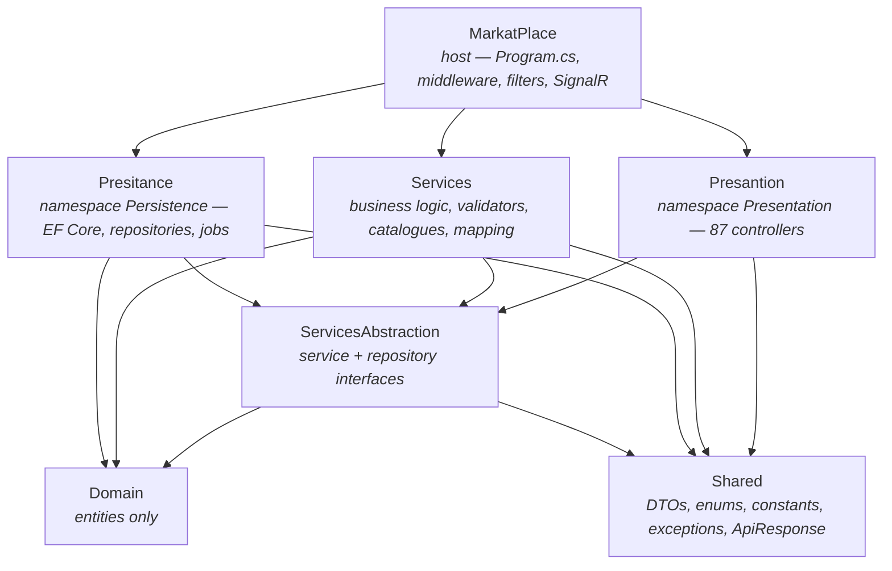

# 00 — Start Here

> **You are reading the handover documentation for the Shopiklopik backend.**
> Everything in this folder was written by reading the repository at commit `f757f64` on
> **2026-09-25**. Where a statement could be checked by running something, it was.

---

## 1. What Shopiklopik is

Shopiklopik (repository name **MarkatPlace**, Arabic product name **ماركت بليس**) is a
classified-advertisements marketplace for the **Fayoum governorate (الفيوم)** in Egypt.

People post a car, a plot of land, a flock of sheep, a job vacancy, a lost wallet or a blood-donation
request through one guided form. An administrator reviews it. Other people browse, filter, favourite,
rate, comment on and report it.

The site it serves lives at **https://shopiklopik.com**; this backend answers at
**https://api.shopiklopik.com**.

### The problem it solves

Fayoum has no single local place to buy, sell, hire, or ask. Shopiklopik is the structured
alternative — one form per kind of listing, a review queue in front of everything, and a 30-day
publication window so the feed does not rot.

---

## 2. What the backend is responsible for

| Responsibility | Where it lives |
| --- | --- |
| Identity: registration, login, Google sign-in, JWT issuing, password reset by e-mailed OTP | `Core/Services/AuthService.cs` |
| 49 independent listing modules (create / read / update / delete / search / filter) | `Core/Services/**`, `Infastrucre/Presitance/Repositories/**` |
| A **dynamic form contract** the frontend renders without holding business logic | `Core/Services/AdForms/` |
| Moderation: every listing is created pending, and only an administrator publishes it | `Core/Services/Admin/AdminAdService.cs` |
| Cross-module interactions: views, favourites, 1–5 star ratings, comments, reports | `Core/Services/Listings/`, `MarkatPlace/Filters/ListingStatsFilter.cs` |
| Notifications, persisted and pushed live over SignalR | `Core/Services/NotificationService.cs`, `MarkatPlace/RealTime/` |
| An administration API with per-page permission grants | `Infastrucre/Presantion/Controllers/Admin/` |
| A paid banner marketplace and a manual (screenshot-proof) payment flow | `Core/Services/BannerBookings/`, `Core/Services/PaymentService.cs` |
| A referral / invitation programme | `Core/Services/Referrals/` |
| File uploads (images, videos, CVs), validated by magic bytes and served as static files | `Infastrucre/Presitance/Services/FileService.cs` |

**It is an API only.** There is no server-rendered UI. The only HTML the backend produces is the
password-reset e-mail and the Swagger page.

---

## 3. Main technologies

Verified from the `*.csproj` files — nothing here is assumed.

| Layer | Technology |
| --- | --- |
| Runtime | .NET 10 / ASP.NET Core Web API (`net10.0`) |
| Language | C# with `<Nullable>enable</Nullable>` and implicit usings |
| Database | SQL Server via EF Core 10.0.10 (code-first, **60 migrations**) |
| Identity | ASP.NET Core Identity (`IdentityDbContext<ApplicationUser>`) + JWT bearer |
| Validation | FluentValidation 12.1.1, applied by a global action filter, answering **HTTP 422** |
| Mapping | AutoMapper (one profile per module, ~50 profiles) |
| Real-time | SignalR, hub at `/hubs/notifications` |
| E-mail | MailKit / MimeKit over Gmail SMTP |
| API docs | Swashbuckle 9.0.6 — two OpenAPI documents (`v1` public, `v2` admin) |
| Tests | xUnit — `Tests/MarkatPlace.Tests`, **2,217 tests, all passing** (verified 2026-09-25) |
| Hosting | Kestrel behind **Nginx** on Ubuntu Linux. No IIS. |

---

## 4. High-level architecture

Onion architecture. Dependencies point inward; `Domain` knows nothing about HTTP or EF Core.



> ### The two folder names are misspelled on purpose
> `Infastrucre/Presitance` and `Infastrucre/Presantion` are misspelled **folder and project** names.
> Their **namespaces are spelled correctly**: `Persistence` and `Presentation`.
> Do not rename them. See [33-ARCHITECTURE-DECISIONS.md](33-ARCHITECTURE-DECISIONS.md).

---

## 5. Where the important code lives

```
MarkatPlace.slnx                     Solution — 7 projects + 1 test project
├── Core/
│   ├── Domain/                      Entities only. No EF, no HTTP.              (128 .cs)
│   ├── ServicesAbstraction/         Interfaces for services and repositories.   (148 .cs)
│   └── Services/                    Business logic, validators, catalogues.     (277 .cs)
├── Infastrucre/
│   ├── Presitance/   → namespace Persistence   DbContext, configs, repos, migrations, jobs (344 .cs)
│   └── Presantion/   → namespace Presentation  Controllers only.                 (89 .cs)
├── Shared/                          DTOs, enums, constants/catalogues, ApiResponse (447 .cs)
├── MarkatPlace/                     Host: Program.cs, middleware, filters, wwwroot (30 .cs)
├── Tests/MarkatPlace.Tests/         xUnit test project                           (28 .cs)
├── deploy/nginx/                    The committed production Nginx site
├── docs/                            The older in-repo documentation set (still accurate)
└── fix-migration-history.sql        One-off repair script — see 30-TROUBLESHOOTING.md
```

The five files worth opening first:

1. `MarkatPlace/Program.cs` — the whole pipeline in one file.
2. `Infastrucre/Presitance/DependencyInjection.cs` — every repository and hosted service.
3. `Core/Services/DependencyInjection.cs` — every service, validator and mapping profile.
4. `Infastrucre/Presitance/Data/AppDbContext.cs` — every table in the system.
5. `Shared/Constants/UserMessages.cs` — every customer-facing sentence in the product.

---

## 6. How authentication works (high level)

`POST /api/auth/login` → Identity checks the password → a **JWT access token** (40 days) and an
opaque **refresh token** (60 days, stored on the user row) come back. The client sends
`Authorization: Bearer <token>` on every later call.

Two things then run on *every authenticated request*:

- **A claims transformation** re-reads roles and account status from the database, so a promotion or
  a suspension takes effect on the very next request rather than at the next login.
- **`AccountStatusMiddleware`** refuses a suspended, blocked or deactivated account with 403.

Google sign-in (`POST /api/auth/google`) verifies a Google ID token server-side and issues the same
pair of tokens. Password reset is a three-step OTP flow that never trusts the client with an e-mail
address after step one.

Full detail: [09-AUTHENTICATION.md](09-AUTHENTICATION.md).

---

## 7. How listings work (high level)

1. The frontend asks `GET /api/lookups/create-ad-form/{categoryId}/{subCategoryId}` and gets back the
   fields, the conditional rules, the lookup options **and the URL to submit to**.
2. It POSTs multipart form data to that URL.
3. The listing is stored with `ModerationStatus = Pending`. It is **not public**.
4. An administrator approves it. Only then does the 30-day publication window open.
5. Any owner edit sends it straight back to `Pending` — enforced by one EF `SaveChanges` interceptor,
   not by 49 copies of the same code.

Full detail: [12-LISTINGS.md](12-LISTINGS.md) and [32-BUSINESS-RULES.md](32-BUSINESS-RULES.md).

---

## 8. How e-mail works (high level)

There is exactly **one** transactional e-mail in the product: the **password-reset OTP**.
`EmailService` (MailKit) sends it over Gmail SMTP; every word, colour and piece of markup lives in
`Shared/Constants/EmailCatalog.cs`, which builds an RTL Arabic HTML layout plus a plain-text
fallback. The SMTP password is **never** in a committed file.

Full detail: [15-EMAIL-SYSTEM.md](15-EMAIL-SYSTEM.md).

---

## 9. How the database works (high level)

One SQL Server database, one `AppDbContext`, roughly 400 `DbSet`s. Code-first: **migrations are
applied automatically at start-up** by `db.Database.MigrateAsync()` in `Program.cs`. Listing tables
carry a soft-delete (`IsDeleted`) global query filter *and* a moderation query filter; both are
**named** filters so a query can drop one without resurrecting deleted rows.

Full detail: [07-DATABASE.md](07-DATABASE.md), [08-DATABASE-MIGRATIONS.md](08-DATABASE-MIGRATIONS.md).

---

## 10. How production deployment works (high level)

```
Browser → Nginx (TLS, 443) → Kestrel (127.0.0.1:5000) → Shopiklopik API → SQL Server
```

Publish with `dotnet publish -c Release`, copy the output to the application directory on the Ubuntu
VPS, restart the systemd unit, check `/health`. Migrations apply themselves on start-up. TLS is
terminated by Nginx; Kestrel holds no certificate.

Full detail: [26-DEPLOYMENT.md](26-DEPLOYMENT.md), [27-PRODUCTION-SERVER.md](27-PRODUCTION-SERVER.md),
[28-NGINX.md](28-NGINX.md), [29-SYSTEMD.md](29-SYSTEMD.md).

---

## 11. How to run the project locally (the short version)

```bash
git clone <repository-url>
cd MarkatPlace

dotnet build MarkatPlace.slnx

# appsettings.json's DefaultConnection points at the SHARED HOSTED database.
# Always override it before you run anything.
export ConnectionStrings__DefaultConnection='Server=(localdb)\MSSQLLocalDB;Database=ShopiklopikDev;Trusted_Connection=True;MultipleActiveResultSets=True;TrustServerCertificate=True'

cd MarkatPlace && dotnet run          # migrations apply automatically
```

Then open **https://localhost:7139/swagger** (or http://localhost:5002/swagger).

Full walkthrough, including the failure modes: [04-DEVELOPMENT-SETUP.md](04-DEVELOPMENT-SETUP.md).

---

## 12. Quick reference

| Thing | Where |
| --- | --- |
| **Swagger** | `/swagger` — two documents in the picker: *MarkatPlace V1* and *MarkatPlace Admin V2*. Basic-auth protected outside Development. |
| **Health** | `GET /health/live` (process) and `GET /health` (process + database) |
| **SignalR** | `wss://<host>/hubs/notifications?access_token=<jwt>` |
| **Uploads** | `https://<host>/uploads/<folder>/<file>` |
| **Tests** | `dotnet test Tests/MarkatPlace.Tests/MarkatPlace.Tests.csproj` |
| **Configuration** | `MarkatPlace/appsettings*.json` + environment variables (`__` separator) |
| **Older in-repo docs** | `docs/` — 18 files, still accurate, more narrative than this handbook |

---

## 13. The 30-minute onboarding path

Follow this in order. It is designed to get you from nothing to a running, understood system.

| # | Minutes | Do this |
| --- | --- | --- |
| 1 | 0–4 | **Read this file** to the end. |
| 2 | 4–9 | Read [02-ARCHITECTURE.md](02-ARCHITECTURE.md) — especially the *seams* section, which explains why 49 modules are not 49 copies of everything. |
| 3 | 9–12 | Skim [03-PROJECT-STRUCTURE.md](03-PROJECT-STRUCTURE.md) so you know where a given kind of code belongs. |
| 4 | 12–18 | **Run the project locally** with [04-DEVELOPMENT-SETUP.md](04-DEVELOPMENT-SETUP.md). Do not skip the connection-string override. |
| 5 | 18–21 | **Open Swagger**, call `GET /api/lookups/categories-tree`, then `GET /api/lookups/create-ad-form/6/21` and read what comes back. That one response explains the whole product. |
| 6 | 21–23 | **Run the tests**: `dotnet test Tests/MarkatPlace.Tests/MarkatPlace.Tests.csproj`. Expect 2,217 passing in under a minute. |
| 7 | 23–26 | Read [09-AUTHENTICATION.md](09-AUTHENTICATION.md) and register + log in through Swagger. |
| 8 | 26–29 | Read [12-LISTINGS.md](12-LISTINGS.md) and follow one module end to end: `LandsController` → `LandService` → `LandRepository`. |
| 9 | 29–30 | Skim [26-DEPLOYMENT.md](26-DEPLOYMENT.md) so you know what happens when you push. |

Before your first commit, also read:

- [32-BUSINESS-RULES.md](32-BUSINESS-RULES.md) — the rules that cause real damage when broken.
- [22-SECURITY.md](22-SECURITY.md) — including the **known open risks** listed there.
- [36-NEW-DEVELOPER-CHECKLIST.md](36-NEW-DEVELOPER-CHECKLIST.md) — the printable version of all of this.

---

## 14. Full document index

| # | Document | Read it when you need to… |
| --- | --- | --- |
| 00 | [START HERE](00-START-HERE.md) | Orient yourself (this file) |
| 01 | [PROJECT OVERVIEW](01-PROJECT-OVERVIEW.md) | Know exactly which technologies are in play |
| 02 | [ARCHITECTURE](02-ARCHITECTURE.md) | Understand the layers and where code belongs |
| 03 | [PROJECT STRUCTURE](03-PROJECT-STRUCTURE.md) | Find a file |
| 04 | [DEVELOPMENT SETUP](04-DEVELOPMENT-SETUP.md) | Get it running locally |
| 05 | [CONFIGURATION](05-CONFIGURATION.md) | Understand every settings section |
| 06 | [ENVIRONMENT VARIABLES](06-ENVIRONMENT-VARIABLES.md) | Configure a server |
| 07 | [DATABASE](07-DATABASE.md) | Work with entities and relationships |
| 08 | [DATABASE MIGRATIONS](08-DATABASE-MIGRATIONS.md) | Add or apply a migration |
| 09 | [AUTHENTICATION](09-AUTHENTICATION.md) | Understand login, JWT, reset |
| 10 | [AUTHORIZATION](10-AUTHORIZATION.md) | Understand who may do what |
| 11 | [USERS, ROLES, PERMISSIONS](11-USERS-ROLES-PERMISSIONS.md) | Manage accounts and admins |
| 12 | [LISTINGS](12-LISTINGS.md) | Understand the core domain |
| 13 | [CATEGORIES & LOOKUPS](13-CATEGORIES-LOOKUPS.md) | Understand the dynamic form system |
| 14 | [ADVERTISER LOOKUP](14-ADVERTISER-LOOKUP.md) | Work on the advertiser filter |
| 15 | [EMAIL SYSTEM](15-EMAIL-SYSTEM.md) | Change or debug e-mail |
| 16 | [FILE UPLOADS](16-FILE-UPLOADS.md) | Work on uploads |
| 17 | [SIGNALR / REALTIME](17-SIGNALR-REALTIME.md) | Work on live notifications |
| 18 | [CACHING](18-CACHING.md) | Understand or change caching |
| 19 | [RATE LIMITING](19-RATE-LIMITING.md) | Change the limits |
| 20 | [BACKGROUND SERVICES](20-BACKGROUND-SERVICES.md) | Understand the scheduled work |
| 21 | [VALIDATION & ERROR HANDLING](21-VALIDATION-AND-ERROR-HANDLING.md) | Understand status codes and messages |
| 22 | [SECURITY](22-SECURITY.md) | Review or harden security |
| 23 | [SWAGGER](23-SWAGGER.md) | Reach or protect the API docs |
| 24 | [API GUIDE](24-API-GUIDE.md) | Call the API |
| 25 | [TESTING](25-TESTING.md) | Run or write tests |
| 26 | [DEPLOYMENT](26-DEPLOYMENT.md) | Ship a change |
| 27 | [PRODUCTION SERVER](27-PRODUCTION-SERVER.md) | Operate the VPS |
| 28 | [NGINX](28-NGINX.md) | Change the reverse proxy |
| 29 | [SYSTEMD](29-SYSTEMD.md) | Manage the service unit |
| 30 | [TROUBLESHOOTING](30-TROUBLESHOOTING.md) | Fix something broken |
| 31 | [ROLLBACK](31-ROLLBACK.md) | Undo a bad deployment |
| 32 | [BUSINESS RULES](32-BUSINESS-RULES.md) | Avoid breaking existing behaviour |
| 33 | [ARCHITECTURE DECISIONS](33-ARCHITECTURE-DECISIONS.md) | Understand why something odd exists |
| 34 | [TECHNICAL DEBT](34-TECHNICAL-DEBT.md) | Know what is already known to be wrong |
| 35 | [FUTURE IMPROVEMENTS](35-FUTURE-IMPROVEMENTS.md) | Plan the next work |
| 36 | [NEW DEVELOPER CHECKLIST](36-NEW-DEVELOPER-CHECKLIST.md) | Onboard |
| — | [diagrams/](diagrams/SYSTEM-ARCHITECTURE.md) | See it rather than read it |
