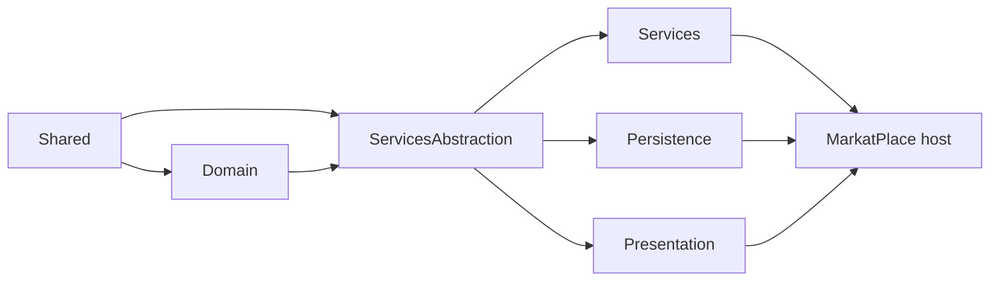

# 02 — Architecture

[← Start Here](00-START-HERE.md) · Related: [03-PROJECT-STRUCTURE](03-PROJECT-STRUCTURE.md) ·
[diagrams/SYSTEM-ARCHITECTURE](diagrams/SYSTEM-ARCHITECTURE.md) ·
[diagrams/REQUEST-FLOW](diagrams/REQUEST-FLOW.md)

This describes the architecture **that exists**, verified from the `.csproj` reference graph and from
reading the code — not an idealised one.

---

## 1. The one-line summary

> Onion architecture with a shared kernel: `Domain` and `Shared` at the centre,
> `ServicesAbstraction` as the contract layer, `Services` and `Persistence` implementing it on either
> side, `Presentation` (controllers) depending only on contracts, and the `MarkatPlace` host wiring
> it all together.

---

## 2. The request path

```
HTTP request
   ↓
Nginx (TLS, static /uploads, 413 guard)          ← production only
   ↓
Kestrel
   ↓
Middleware pipeline  (Program.cs, in order)
   ↓
Controller           (Infastrucre/Presantion)     thin: bind, delegate, wrap in ApiResponse
   ↓
Service              (Core/Services)              ALL business logic lives here
   ↓
Repository           (Infastrucre/Presitance)     ALL EF Core queries live here
   ↓
AppDbContext → EF Core → SQL Server
```

The controller never sees an entity; the service never sees `HttpContext`; the repository never
decides a business rule.

---

## 3. The projects and what each is responsible for

| Project | Namespace | Depends on | Responsibility | Must never contain |
| --- | --- | --- | --- | --- |
| `Shared` | `Shared` | *(nothing — only `Microsoft.AspNetCore.App` framework reference)* | DTOs, enums, constants/catalogues, exceptions, `ApiResponse`, settings POCOs | business logic, EF, data access |
| `Core/Domain` | `Domain` | `Shared` | Entities and entity interfaces only | EF configuration, attributes beyond `[NotMapped]`, HTTP |
| `Core/ServicesAbstraction` | `ServicesAbstraction` | `Domain`, `Shared` | Interfaces: `I*Service`, `I*Repository`, and infrastructure seams (`IEmailService`, `ITokenService`, `IFileService`, `IRealtimeNotifier`, `IUnitOfWork`) | implementations |
| `Core/Services` | `Services` | `ServicesAbstraction`, `Domain`, `Shared` | Business logic, FluentValidation validators, AutoMapper profiles, catalogues, caching policy | EF Core, `HttpContext`, SQL |
| `Infastrucre/Presitance` | **`Persistence`** | `Domain`, `ServicesAbstraction`, `Shared` | `AppDbContext`, EF configurations, repositories, migrations, interceptors, hosted services, SMTP/JWT/Google/file implementations | controllers, business rules |
| `Infastrucre/Presantion` | **`Presentation`** | `ServicesAbstraction`, `Shared` | Controllers **only** — 87 of them | business logic, EF, entity types (it cannot even see `Domain`) |
| `MarkatPlace` | `MarkatPlace` | all of the above | Host: `Program.cs`, middleware, MVC filters, SignalR hub, Swagger wiring, `wwwroot` | domain logic |
| `Tests/MarkatPlace.Tests` | `MarkatPlace.Tests` | all of the above | xUnit tests, including source-scanning architecture tests | — |

### Dependency direction (enforced by the reference graph)



Two consequences worth internalising:

1. **`Presentation` cannot reference `Domain`.** A controller literally cannot type the name of an
   entity. That is what keeps controllers thin.
2. **`Services` cannot reference `Persistence`.** Business logic talks to repository *interfaces*.
   That is what makes `Services` unit-testable without a database.

---

## 4. Where each kind of code belongs

| Kind of code | Belongs in | Example |
| --- | --- | --- |
| HTTP binding, status codes, `ApiResponse` wrapping | `Presentation` controller | `LandsController.Create` |
| Business rule / workflow | `Services` | `AdminAdService.ApproveAsync` opens the publication window |
| Input validation | `Services/Validation/*Validator.cs` (FluentValidation) | `AdvertiserLookupParamsValidator` |
| Ownership / permission check | `Services` (and the `AdminPermissionFilter` for admin routes) | owner-or-admin checks inside each module service |
| Database query | `Persistence/Repositories` | `AdvertiserLookupRepository.GetPagedAsync` |
| Table shape, index, relationship, query filter | `Persistence/Configurations` | `BirdConfigurations` |
| Entity | `Domain/Entities` | `Advertisement`, `Land`, `Bird` |
| Request/response shape | `Shared/DTOs` | `CreateLandRequest`, `AdvertiserOptionDto` |
| Enum | `Shared/Enums` | `ListingModuleType`, `ModerationStatus` |
| Constant, Arabic wording, business catalogue | `Shared/Constants` | `UserMessages`, `NotificationCatalog` |
| Configuration POCO | `Shared/Settings` | `JwtSettings`, `CorsSettings` |
| Cross-cutting HTTP behaviour | `MarkatPlace/Middleware` or `MarkatPlace/Filters` | `AccountStatusMiddleware`, `ValidationFilter` |

### Validation: the exact rule

- Validators are **FluentValidation** classes in `Core/Services/Validation/`, registered by
  `AddValidatorsFromAssemblyContaining<RegisterRequestValidator>` with **scoped** lifetime.
- They run in a **global action filter** (`ValidationFilter`), not in the controller.
- A failure is **HTTP 422** with `{ success: false, message, errors: [...] }` in Arabic.
- `ApiBehaviorOptions.SuppressModelStateInvalidFilter = true` — so **DataAnnotations attributes are
  inert**. If you put `[Required]` on a DTO it does nothing. Write a FluentValidation rule.

### Authorization: the exact rule

- `[Authorize]` / `[AllowAnonymous]` decide *authenticated or not*.
- `AccountStatusMiddleware` decides *is this account still usable*.
- `AdminPermissionFilter` (a global `IAsyncAuthorizationFilter`) decides *may this administrator do
  this on this page* — and it **fails closed**: an admin endpoint with no
  `[RequireAdminPermission]` is refused and logged as an error.
- Per-resource ownership ("is this your listing?") is checked **inside the service**.

---

## 5. The seams — why 49 modules are not 49 copies of everything

Each listing module has its own table, entity, repository, service, controller, validator, DTOs and
lookups. What stops that from being 49 copies of every cross-cutting feature is a set of **seams**: a
small interface or catalogue that one implementation reads for all modules.

| Seam | Type | What it gives every module for free |
| --- | --- | --- |
| `IModeratedListing` | interface on the entity | approve / reject / suspend, the moderation query filter, the pending queue |
| `IExpiringListing` | interface on the entity | the 30-day publication window, expiry, republish |
| `IUserListingSource` | interface, ~49 implementations registered in DI | `GET /api/profile/my-listings` across every module |
| `IListingModerationSource` | generic `ListingModerationSource<T>` registered per module via `ModerationModuleRegistry` | the admin cross-module ad list and details |
| `IListingStats` / `IListingViews` | interfaces on the **DTO** | `views`, `averageRating`, `ratingsCount`, `isFavorite` filled by one result filter in one batched query |
| `ListingEditModerationInterceptor` | EF `SaveChangesInterceptor` | "any owner edit returns the listing to review", once, for all modules |
| `ListingModuleCatalog` | static catalogue | module ↔ sub-category ↔ category ↔ route resolution |
| `NotificationCatalog` | static catalogue | every notification's wording, icon, entity name and deep link |
| `AdFormSchemaCatalog` | static catalogue | the dynamic create-form contract |
| `ReadConfigCatalog` | static catalogue | which GET endpoints exist for a given category/sub-category |
| `AdminPageCatalog` | static catalogue | the only definition of admin pages and their permissions |
| `UserMessages` | static catalogue | every customer-facing sentence |

**This is the single most important architectural idea in the codebase.** When you add a feature that
should apply to all listings, add it to a seam. When you add a feature that applies to one module,
add it to that module. Do not add a base class.

---

## 6. The middleware pipeline, in order

Read straight from `Program.cs`. Order matters; several entries are where they are for a specific
reason noted below.

| # | Component | Note |
| --- | --- | --- |
| 1 | `UseForwardedHeaders` | **first**, so everything downstream sees the real client IP, scheme and host |
| 2 | `GlobalExceptionHandlingMiddleware` | maps `AppException` → status code + Arabic message; preserves CORS headers across `Response.Clear()` |
| 3 | `SqlDiagnosticsMiddleware` | only when `Diagnostics:SqlCounter` is true; adds `X-Sql-Count`, `X-Sql-Ms`, `X-Elapsed-Ms` |
| 4 | `UseStatusCodePages` | gives 404/405/413/415 an Arabic JSON body instead of an empty response |
| 5 | `UseHsts` | non-Development only |
| 6 | security headers | `X-Content-Type-Options`, `X-Frame-Options: DENY`, `Referrer-Policy: no-referrer`, `X-XSS-Protection: 0` |
| 7 | `SwaggerBasicAuthMiddleware` | guards `/swagger` only |
| 8 | swagger `no-store` shim | stops Swashbuckle's 7-day cache of the generated document picker |
| 9 | `UseSwagger` / `UseSwaggerUI` | two documents: `v1`, `v2` |
| 10 | `UseHttpsRedirection` | only acts if an HTTPS port can be resolved |
| 11 | `UseResponseCompression` | Brotli, then Gzip |
| 12 | `UseStaticFiles` (uploads) | own `PhysicalFileProvider`, pinned content types, immutable cache, `ServeUnknownFileTypes = false`, sandbox CSP |
| 13 | `UseStaticFiles` (wwwroot) | |
| 14 | `UseCors` | named policy `MarkatPlaceCors` |
| 15 | `UseResponseCaching` | works with `[HttpCache]` on the controller actions |
| 16 | `UseAuthentication` | JWT bearer; the claims transformation runs here |
| 17 | `AccountStatusMiddleware` | **after** authentication, **before** authorization — refuses suspended/blocked/deactivated accounts |
| 18 | `UseAuthorization` | |
| 19 | `UseRateLimiter` | so a signed-in caller is partitioned by account, not by address |
| 20 | `MapControllers`, `MapHealthChecks`, `MapHub` | health checks are `AllowAnonymous` + `DisableRateLimiting` |

After the pipeline is built and **before** `app.Run()`, a start-up scope runs migrations, seeds
identity, and (Development only) seeds demo data.

---

## 7. Global MVC filters

Registered in `AddControllers(options => …)` — they run on **every** action.

| Filter | Kind | What it does |
| --- | --- | --- |
| `AdminPermissionFilter` | authorization filter | fail-closed per-page admin permission check |
| `ValidationFilter` | action filter | runs the FluentValidation validator for every bound argument → 422 |
| `ListingInteractionFilter` | action filter | on a successful listing GET, queues a view; on DELETE, purges interactions |
| `PendingListingAlertFilter` | action filter | on a 201 Created listing, alerts administrators there is something to review |
| `ListingStatsFilter` | result filter | walks the response object graph and fills `views`/`isFavorite`/`averageRating`/`ratingsCount` in one batched query |
| `ListingEditReviewFilter` | action filter | announces listings the request's edits pushed back into the review queue |

> Each of these swallows and logs its own exceptions: a bookkeeping failure must never turn a
> successful request into a 500.

---

## 8. Transactions and the unit of work

`IUnitOfWork.ExecuteInTransactionAsync` is the **only** supported way to run an explicit
transaction. This is not style — EF Core's retrying execution strategy *refuses* user-initiated
transactions, so `BeginTransactionAsync` called directly will throw under the configured
`EnableRetryOnFailure`. `ExecuteInTransactionAsync` runs the block inside the execution strategy and
clears the change tracker before each attempt so a retry starts clean.

`IUnitOfWork.IsUniqueConstraintViolation(exception)` maps SQL Server errors 2601/2627 to a
409 Conflict without letting `Core` reference EF Core.

---

## 9. Response shape

Every endpoint returns the same envelope:

```json
{ "success": true, "message": "تم التحميل بنجاح", "data": { }, "errors": null }
```

`data` and `errors` are always present (`JsonIgnoreCondition.Never`), so a client never has to
distinguish "absent" from "null". Paginated endpoints put a `PaginatedResult<T>` in `data`:

```json
{ "items": [], "pageIndex": 1, "pageSize": 20, "totalCount": 0, "totalPages": 0,
  "hasPrevious": false, "hasNext": false }
```

---

## 10. What this architecture optimises for, and what it costs

**Optimises for:** adding a whole new listing type without touching any other listing type, and
changing a cross-cutting behaviour in exactly one place.

**Costs:** a lot of files. 49 modules × (entity + configuration + repository + service + controller +
validator + DTOs + mapping profile) is the bulk of the ~1,460 C# files. Finding "the code" for a
feature means knowing which of those layers owns it — which is what
[03-PROJECT-STRUCTURE.md](03-PROJECT-STRUCTURE.md) is for.
