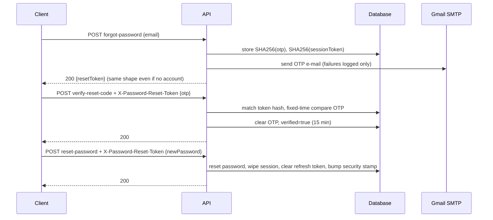

# 09 — Authentication

[← Start Here](00-START-HERE.md) · Related: [10-AUTHORIZATION](10-AUTHORIZATION.md) ·
[diagrams/AUTH-FLOW](diagrams/AUTH-FLOW.md) ·
[diagrams/PASSWORD-RESET-FLOW](diagrams/PASSWORD-RESET-FLOW.md)

---

## Authentication vs authorization

| | Authentication | Authorization |
| --- | --- | --- |
| Question | **Who are you?** | **May you do this?** |
| Answer from | a JWT signed by this API, or a Google ID token exchanged for one | roles + per-page permission grants + ownership checks |
| Fails with | **401 Unauthorized** | **403 Forbidden** |
| Implemented by | `AuthService`, `JwtService`, `AddJwtAuthentication` | `AdminPermissionFilter`, `[Authorize]`, in-service owner checks |
| This document | ✅ | [10-AUTHORIZATION.md](10-AUTHORIZATION.md) |

A subtlety worth knowing: **account state** sits between the two. A valid token belonging to a
blocked account authenticates fine and is then refused **403** by `AccountStatusMiddleware`.

---

## The endpoints

All under `/api/auth`, all rate-limited by the strict `auth` policy (20 requests/minute).

| Method | Route | Auth | Purpose |
| --- | --- | --- | --- |
| POST | `/api/auth/register` | anonymous | create an account → **201** with tokens |
| POST | `/api/auth/login` | anonymous | username + password → **200** with tokens |
| POST | `/api/auth/google` | anonymous | Google ID token (or code) → **200** (existing) / **201** (new account) |
| GET | `/api/auth/google/config` | anonymous | `{ enabled, clientId }` — never the secret |
| POST | `/api/auth/refresh-token` | anonymous | refresh token (+ optional expired access token) → new pair |
| POST | `/api/auth/forgot-password` | anonymous | e-mail → sends an OTP, returns an opaque `resetToken` |
| POST | `/api/auth/verify-reset-code` | anonymous + `X-Password-Reset-Token` | OTP → opens a 15-minute verified window |
| POST | `/api/auth/reset-password` | anonymous + `X-Password-Reset-Token` | new password |
| POST | `/api/auth/logout` | **authenticated** | clears the stored refresh token |

---

## Registration

`POST /api/auth/register`

```json
{ "firstName": "…", "secondName": "…", "username": "…", "email": "…",
  "phone": "01…", "password": "…", "center": "سنورس", "referralCode": "ABC123" }
```

What happens, in order:

1. Uniqueness pre-checks on username, e-mail and phone → **409 Conflict** with an Arabic message.
2. Inside `IUnitOfWork.ExecuteInTransactionAsync`:
   - the referral code (if any) is resolved to a referrer;
   - the user is created with `Governorate = "الفيوم"`, a generated unique `ReferralCode`;
   - a `Referral` row is written **in the same transaction**;
   - commit.
3. A welcome notification is created.
4. The referrer is notified (failure here is logged, never fatal).
5. Tokens are issued → **201 Created**.

### Uniqueness races

Two simultaneous registrations with the same phone number used to produce a 500. Now the
`DbUpdateException` is caught by `IUnitOfWork.IsUniqueConstraintViolation` (SQL errors 2601/2627) and
reported as a **409 Conflict** — without giving `Core` a reference to EF Core.

### Password policy (`AddIdentityCore`)

| Rule | Value |
| --- | --- |
| Minimum length | 8 |
| Requires digit / lowercase / uppercase / non-alphanumeric | all ✅ |
| Unique characters | 1 |
| Unique e-mail required | ✅ |
| Lockout | 5 failed attempts → 15 minutes |
| Confirmed e-mail required to sign in | ❌ (`SignIn.RequireConfirmedEmail = false`) |

### Usernames

`options.User.AllowedUserNameCharacters = string.Empty` — deliberately **emptied**. Identity's
default allow-list is ASCII-only and vetoes Arabic usernames. Validation is done by
`AccountNameRules` instead, which permits Arabic and Latin names.

---

## Login

`POST /api/auth/login` with `{ "username": "...", "password": "..." }`.

1. Find by username → **401** "اسم المستخدم أو كلمة السر غلط." if absent.
2. Locked out? → **401** with the lockout message.
3. Wrong password → `AccessFailedAsync` (counts toward lockout) → **401**, *same message as an
   unknown user* — no account enumeration.
4. Account not `Active` → **403** with the reason (`Suspended` / `Blocked` / `Deactivated`).
5. Reset the failed-access counter, create a "new login" notification, issue tokens.

---

## The tokens

### Access token (JWT)

| Property | Value |
| --- | --- |
| Algorithm | HMAC-SHA256 |
| Lifetime | **40 days** (`JwtSettings:AccessTokenExpirationDays`) |
| Issuer / audience | `MarkatPlaceAPI` / `MarkatPlaceClient`, both validated |
| Clock skew | **zero** |
| Claims | `sub`, `nameidentifier`, `jti`, `name`, `unique_name`, `email`, and one `role` claim per role |

### Refresh token

| Property | Value |
| --- | --- |
| Format | 64 random bytes, Base64 — opaque, not a JWT |
| Lifetime | **60 days** |
| Storage | `AspNetUsers.RefreshToken` + `RefreshTokenExpiryTime` — **one live token per user** |
| Rotation | every issue overwrites it, so refreshing invalidates the previous one |

`POST /api/auth/refresh-token` looks the user up **by the refresh token**, checks expiry and account
state, and — if the (expired) access token was also sent — verifies that its subject matches the same
user before issuing a new pair.

> **A 40-day access token is a long time.** Because the token itself cannot be revoked, revocation is
> done at request time instead: see *Instant revocation* below.

### Logout

`POST /api/auth/logout` clears `RefreshToken` and `RefreshTokenExpiryTime`. The **access token
remains valid until it expires** — logout ends the session's ability to renew, not the token itself.
Clients must discard the access token.

---

## Instant revocation — how a 40-day token stops working

Two components run on every authenticated request:

### 1. `DatabaseRoleClaimsTransformation` (an `IClaimsTransformation`)

Re-reads the user's **roles and account status from the database** and rewrites the claims on the
principal, discarding whatever the token said. One query returns both.

- On administration routes (`/api/v2/admin/**`, legacy `/api/admin/**`) it reads the database
  **every time** — so granting or revoking an admin permission takes effect immediately.
- Elsewhere it uses `IUserAccessStateCache`, an in-process memory cache with a **5-minute** lifetime
  and a 20,000-entry cap.

This is what makes a promoted user an administrator without logging out and back in: the role claim
is checked by the authorization middleware *before* any MVC filter runs, so rewriting it here is the
only place that works.

### 2. `AccountStatusMiddleware`

Runs **after** `UseAuthentication` and **before** `UseAuthorization`. It reads the
`markatplace:account-status` claim the transformation just wrote:

| Claim value | Response |
| --- | --- |
| `Active` | continue |
| `Suspended` / `Blocked` / `Deactivated` | **403** with the matching Arabic message |
| `missing` (the account no longer exists) | **401** |
| unparseable | **401** |

Cost: zero extra round trips — roles and status arrive in the same query.

---

## Google sign-in

`POST /api/auth/google`

```json
{ "idToken": "<Google ID token>", "referralCode": "optional", "center": "optional" }
```

Two supported flows:

| Flow | Input | Needs `ClientSecret` |
| --- | --- | --- |
| ID token (default) | `idToken` from Google Identity Services in the browser | ❌ — verified against Google's public keys |
| Authorization code | `code` | ✅ `GoogleAuth__ClientSecret` |

Resolution order in `AuthService.GoogleSignInAsync`:

1. **Already linked?** `FindByLoginAsync("Google", subject)` → sign in. **200**
2. Not linked, and `RequireVerifiedEmail` is on but the Google e-mail is unverified → **401**.
3. **An account with that e-mail exists?**
   - `LinkVerifiedEmailToExistingAccount = true` (default) → link the Google login to it, sign in. **200**
   - otherwise → **409 Conflict**.
4. Otherwise create a new account (username derived from the Google name/e-mail with collision
   retries, `Governorate` defaulted, referral recorded in the same transaction) → **201 Created**.

The identity is stored in **`AspNetUserLogins`** — standard Identity, no custom table, and therefore
no migration was needed to add Google sign-in.

`GET /api/auth/google/config` returns only `{ enabled, clientId }`.

---

## Password reset — the three-step OTP flow

The design goal: **after step 1, the client never sends the e-mail address again.** A leaked or
guessed e-mail is not enough to reset anyone's password.

### Step 1 — `POST /api/auth/forgot-password`

```json
{ "email": "user@example.com" }
```

Always returns **200** with `{ "resetToken": "<64 hex characters>" }`, **whether or not the account
exists** — no account enumeration.

If the account does exist:

| Stored on the user row | Value |
| --- | --- |
| `PasswordResetOtpHash` | SHA-256 of a cryptographically random 6-digit OTP |
| `PasswordResetOtpExpiry` | now + **10 minutes** |
| `PasswordResetTokenHash` | SHA-256 of the returned session token |
| `PasswordResetVerified` | `false` |

The OTP is e-mailed (see [15-EMAIL-SYSTEM.md](15-EMAIL-SYSTEM.md)). **A send failure is caught and
logged, not surfaced** — again to avoid leaking which addresses exist.

### Step 2 — `POST /api/auth/verify-reset-code`

Header: `X-Password-Reset-Token: <resetToken from step 1>`
Body: `{ "otp": "123456" }`

- The session token is hashed and used to find the user — the e-mail is **not** in the request.
- The OTP is compared with `CryptographicOperations.FixedTimeEquals` (constant time).
- On success: the OTP hash is **cleared** (single use), `PasswordResetVerified = true`, and
  `PasswordResetVerifiedExpiry = now + 15 minutes`.

Failures: **400** for a wrong or expired code; **401** for an unknown session token.

### Step 3 — `POST /api/auth/reset-password`

Header: `X-Password-Reset-Token: <same token>`
Body: `{ "newPassword": "…" }`

- Refuses (**401**) unless `PasswordResetVerified` is true and within the 15-minute window.
- Resets the password using an internally generated Identity token.
- Then wipes the **entire** reset session: OTP hash, OTP expiry, **session token hash**, verified
  flag and expiry — and also clears `RefreshToken` and updates the security stamp.
- Creates a "password changed" notification.

Because the session token hash is wiped, the whole flow is **replay-proof**: the same `resetToken`
cannot be used twice.



---

## E-mail verification

**There is none as a gate.** `SignIn.RequireConfirmedEmail = false`, so an unverified e-mail does not
block sign-in. `EmailConfirmed` is set to `true` for Google accounts whose Google e-mail is verified,
and for the bootstrap administrator. No confirmation e-mail is sent anywhere in the codebase.

---

## SignalR authentication

The hub is `[Authorize]`. Browsers cannot set headers on a WebSocket handshake, so the JWT bearer
options accept the token from the query string — **but only for `/hubs` paths**:

```csharp
OnMessageReceived = ctx =>
{
    var accessToken = ctx.Request.Query["access_token"];
    if (!string.IsNullOrEmpty(accessToken) && ctx.HttpContext.Request.Path.StartsWithSegments("/hubs"))
        ctx.Token = accessToken;
    return Task.CompletedTask;
}
```

```
wss://api.shopiklopik.com/hubs/notifications?access_token=<jwt>
```

---

## Error responses

Both are produced by `JwtBearerEvents`, so they carry the standard envelope rather than an empty body:

| Status | Message |
| --- | --- |
| 401 | `لازم تسجل دخولك عشان توصل للمحتوى ده.` |
| 403 | `مالكش صلاحية توصل للمحتوى ده.` |

---

## Security properties worth knowing

| Property | How |
| --- | --- |
| No account enumeration | login, forgot-password and verify all give identical answers for known and unknown accounts |
| OTP never stored in plaintext | SHA-256 only |
| Session token never stored in plaintext | SHA-256 only |
| Constant-time comparison | `CryptographicOperations.FixedTimeEquals` for the OTP and for Swagger basic auth |
| Single-use OTP | hash cleared on first successful verification |
| Replay-proof reset | session token hash wiped after the reset |
| Reset invalidates sessions | `RefreshToken` cleared, security stamp updated |
| Brute force limited | Identity lockout (5/15 min) **and** the 20/min `auth` rate-limit policy |
| Token key cannot be a known-leaked value | start-up refuses a list of published/placeholder keys outside Development |

### Known weaknesses

- **40-day access tokens** cannot be revoked. Mitigated by the per-request status check, not solved.
- **One refresh token per user** means signing in on a second device invalidates the first device's
  refresh token.
- **No e-mail verification gate** — anyone can register with an address they do not control.
