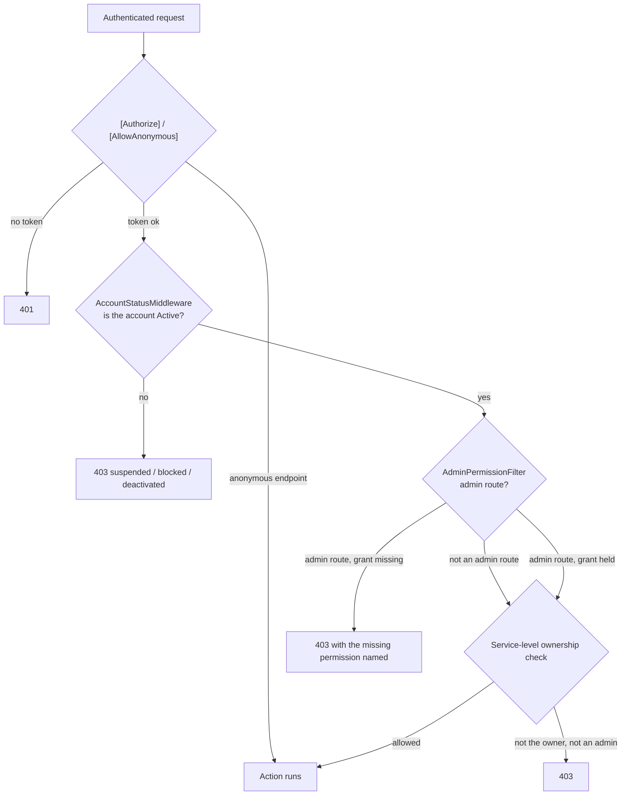

# 10 — Authorization

[← Start Here](00-START-HERE.md) · Related: [09-AUTHENTICATION](09-AUTHENTICATION.md) ·
[11-USERS-ROLES-PERMISSIONS](11-USERS-ROLES-PERMISSIONS.md)

> Authentication answers *who are you*. **Authorization answers *may you do this*.**
> Authentication fails with **401**; authorization fails with **403**.

---

## The four layers

A request passes through up to four independent authorization decisions:



| Layer | Component | Decides |
| --- | --- | --- |
| 1 | `[Authorize]` / `[AllowAnonymous]` | is a valid token required |
| 2 | `AccountStatusMiddleware` | is the account still usable |
| 3 | `AdminPermissionFilter` (global) | may this administrator do this on this page |
| 4 | the service | does this user own this particular row |

---

## Layer 1 — endpoint-level

Most listing controllers are `[Authorize]` at the class level with `[AllowAnonymous]` on the public
reads. `LookupsController` is entirely `[AllowAnonymous]`. Admin controllers inherit from
`AdminApiController`, which is `[Authorize(Roles = AppRoles.Admin)]`.

---

## Layer 2 — account state

`AccountStatusMiddleware` sits between `UseAuthentication` and `UseAuthorization` and reads the
`markatplace:account-status` claim written moments earlier by the claims transformation:

| `UserAccountStatus` | Result |
| --- | --- |
| `Active` | continue |
| `Suspended` | **403** — `تم إيقاف هذا الحساب مؤقتًا` (+ reason if set) |
| `Blocked` | **403** — `تم حظر هذا الحساب` (+ reason if set) |
| `Deactivated` | **403** — the self-deactivation message |
| account row missing | **401** |

This is what makes a suspension effective **on the next request**, even though the access token is
valid for 40 days.

---

## Layer 3 — the admin permission model

### Roles

| Role | Meaning |
| --- | --- |
| `Admin` | may reach `/api/v2/admin/**` at all — but every individual operation still costs a permission |
| `SuperAdmin` | bypasses all page permissions, and is the only role that may manage administrators |

Roles are read **from the database on every administration request** (never from the JWT).

### Pages and permissions

`Shared/Constants/AdminPageCatalog.cs` is the **only** definition of admin pages. Fifteen pages,
grouped for the dashboard UI:

| Key | Arabic | Group | Permissions valid on it |
| --- | --- | --- | --- |
| `dashboard` | لوحة التحكم | عام | View |
| `ads` | الإعلانات | المحتوى | View, Delete, Approve, Reject, Manage |
| `users` | المستخدمون | المحتوى | View, Manage |
| `categories` | الأقسام | المحتوى | View, Create, Edit, Delete, Manage |
| `locations` | المواقع | المحتوى | View, Create, Edit, Delete |
| `banners` | البانرات | الإعلانات المدفوعة | View, Create, Edit, Delete |
| `banner-requests` | طلبات البانرات | الإعلانات المدفوعة | View, Delete, Approve, Reject, Manage |
| `payments` | المدفوعات | الإعلانات المدفوعة | View, Create, Edit, Delete, Approve, Reject, Manage |
| `reports` | البلاغات | المراجعة | View, Manage |
| `feedback` | التقييمات | المراجعة | View, Delete |
| `referrals` | الدعوات | المراجعة | View |
| `forms` | نماذج الإعلانات | الإعدادات | View, Create, Edit, Delete |
| `home` | الصفحة الرئيسية | الإعدادات | View, Edit, Manage |
| `settings` | الإعدادات | الإعدادات | View, Edit, Manage |
| `audit-logs` | سجل الإجراءات | الإعدادات | View |

`AdminPermission` is a **flags enum**, stored as one integer mask per (admin, page) pair in
`AdminPageGrants`:

| Flag | Value | Arabic |
| --- | --- | --- |
| `None` | 0 | — |
| `View` | 1 | عرض |
| `Create` | 2 | إضافة |
| `Edit` | 4 | تعديل |
| `Delete` | 8 | حذف |
| `Approve` | 16 | قبول |
| `Reject` | 32 | رفض |
| `Manage` | 64 | إدارة |

### The four attributes

From `Shared/Authorization/AdminAuthorizationAttributes.cs`:

| Attribute | Applied to | Meaning |
| --- | --- | --- |
| `[AdminPage("ads")]` | controller | which page this controller's operations belong to |
| `[RequireAdminPermission(AdminPermission.Approve)]` | action | the permission this operation costs |
| `[SuperAdminOnly]` | action/controller | SuperAdmin role only; reachable through **no** page grant |
| `[AdminSelfService]` | action | any active administrator, no page grant (e.g. `GET me/permissions`) |

Typical shape:

```csharp
[Route(ApiVersions.AdminRoutePrefix + "/users")]
[AdminPage(AdminPageCatalog.Keys.Users)]
public class AdminUsersController : AdminApiController
{
    [RequireAdminPermission(AdminPermission.View)]
    [HttpGet]
    public async Task<...> GetUsers([FromQuery] AdminUserFilterParams filter) { … }
}
```

### `AdminPermissionFilter` — the enforcement, and why it fails closed

A **global** `IAsyncAuthorizationFilter`. For any endpoint that is an administration endpoint (by
route prefix **or** by inheriting `AdminApiController`), or that carries any of the four attributes:

1. `[AllowAnonymous]` → skip entirely.
2. `[SuperAdminOnly]` → `AuthorizeSuperAdminAsync`.
3. `[AdminSelfService]` → `AuthorizeAdminAsync` (a disabled administrator is still refused).
4. **No `[RequireAdminPermission]`** → **log an error and refuse**. An admin endpoint that forgets
   its attribute is denied, not allowed. This is the important property.
5. **No page key** (neither on the attribute nor via `[AdminPage]`) → log an error and refuse.
6. Otherwise → `AuthorizeAsync(userId, pageKey, permission)`.

`AdminPermissionService.AuthorizeAsync`:

- resolves the administrator (and caches the resolution for the request),
- `SuperAdmin` → allow,
- unknown page key → deny,
- otherwise read the grant mask from the database and test `(mask & permission) == permission`.

The refusal message names what is missing, in Arabic:

| Case | Message |
| --- | --- |
| no grant at all on the page | `مالكش صلاحية توصل للصفحة دي.` |
| grant exists but lacks this permission | `مالكش صلاحية {عرض/إضافة/تعديل/…} على الصفحة دي.` |
| SuperAdmin-only operation | `العملية دي للمسؤول الأعلى بس.` |

> **Grants are read per request, from the database — never from the token.** Granting or revoking a
> permission takes effect immediately, with no re-login.

### Discovering permissions from the API

| Endpoint | Returns |
| --- | --- |
| `GET /api/v2/admin/permissions/pages` | every assignable page and the permissions valid on it |
| `GET /api/v2/admin/me/permissions` | what the signed-in administrator actually holds |

Swagger also publishes each operation's rule, both in the summary text and in a machine-readable
`x-admin-authorization` extension.

---

## Layer 4 — ownership

Cross-cutting filters cannot know whether *this* land listing belongs to *this* user, so ownership is
checked inside each module service. The shape is consistent:

```csharp
private string CurrentUserId => User.FindFirstValue(ClaimTypes.NameIdentifier)!;
private bool IsAdmin => User.IsInRole(AppRoles.Admin);
// … passed to the service, which throws ForbiddenException when neither matches
```

Rules in force across the modules:

| Operation | Who |
| --- | --- |
| edit a listing | owner only |
| delete a listing | owner **or** admin |
| edit a comment | its author only |
| delete a comment | its author **or** an admin |
| approve / reject / suspend | admin with the `ads` page permission |
| see a pending / rejected / suspended / expired listing | its owner, or an admin (`VisibleToViewer`) |

### Fields the server owns

These are **ignored** if a client sends them in a request body — they are never bound from input:

- `ModerationStatus`, `ModeratedAt`, `ModeratedBy`, `RejectionReason`, `ModerationNotes`
- `PublishedAt`, `ExpireAt`, `FirstPublishedAt`, `RepublishCount`
- promotion flags (`IsPremium`, `IsFeatured`)
- `Views`, `AverageRating`, `RatingsCount`, `IsFavorite`
- `UserId` / `OwnerId`

This is the project's mass-assignment defence: request DTOs simply do not carry those properties.

---

## Audit

Every administrative action writes to `AdminAuditLogs` through the centralized
`IAdminAuditService` — action, target type, target id, an Arabic description, old value, new value
and the acting administrator. The log is **append-only**; `GET /api/v2/admin/audit-logs` (View on the
`audit-logs` page) reads it.

`IAdminActionContext` is the seam that tells `Core` who the acting administrator is without giving it
a reference to ASP.NET Core. It also feeds `AppDbContext.ViewerUserId`, which drives
`VisibleToViewer`, and tells `ListingEditModerationInterceptor` that an admin edit must **not** send
a listing back to review.

---

## Adding a new admin endpoint — the checklist

1. Put the controller in `Infastrucre/Presantion/Controllers/Admin/`, inheriting `AdminApiController`.
2. Route it under `ApiVersions.AdminRoutePrefix` (`api/v2/admin`).
3. Add `[AdminPage(AdminPageCatalog.Keys.<Page>)]` to the controller.
4. Add `[RequireAdminPermission(AdminPermission.<X>)]` to **every** action — or it will be refused.
5. If the page is new, add it to `AdminPageCatalog.All` — nowhere else defines a page.
6. Log the action through `IAdminAuditService`.
7. If the action affects a user's listing, notify the owner via `NotificationCatalog`.
