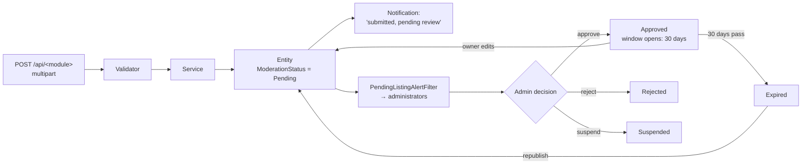

# Modules

[← README](../README.md) · Related: [API](API.md) · [BUSINESS_RULES](BUSINESS_RULES.md) · [DATABASE](DATABASE.md)

15 categories → 64 sub-categories → **60 concrete listing types**. This document explains how a
module actually works, starting with the pattern they all share.

---

## The standard listing module

Nearly every module is the same vertical slice. Learn it once.

### Files a module owns

| Concern | Location |
| --- | --- |
| Entity + images/selections | `Core/Domain/Entities/<Category>/<Module>.cs` |
| Table mapping, indexes, filters | `Infastrucre/Presitance/Configurations/<Category>/<Module>Configurations.cs` |
| Repository | `Infastrucre/Presitance/Repositories/<Module>Repository.cs` |
| Service | `Core/Services/<Category>/<Module>Service.cs` |
| Interfaces | `Core/ServicesAbstraction/I<Module>Repository.cs`, `I<Module>Service.cs` |
| Validators | `Core/Services/Validation/<Module>RequestValidators.cs` |
| Mapping profile | `Core/Services/Mapping/<Module>MappingProfile.cs` |
| DTOs | `Shared/DTOs/<Category>/<Module>/` |
| Enums | `Shared/Enums/<Category>/<Module>Enums.cs` |
| Arabic lookup names | `Shared/Constants/<Category>Catalog.cs` |
| Form schema | `Core/Services/AdForms/AdFormSchemaCatalog.cs` |
| Read routes | `Core/Services/ReadConfigs/ReadConfigCatalog.cs` |
| Controller | `Infastrucre/Presantion/Controllers/<Module>Controller.cs` |

### Endpoints a module publishes

| Method | Route | Auth | Purpose |
| --- | --- | --- | --- |
| `POST` | `/api/<module>` | user | Create — **multipart only** |
| `GET` | `/api/<module>` | anonymous | Paged, filtered, sorted list |
| `GET` | `/api/<module>/{id}` | anonymous | Details (counts a view) |
| `PUT` | `/api/<module>/{id}` | owner or admin | Update — sends back to review |
| `DELETE` | `/api/<module>/{id}` | owner or admin | Soft delete |
| `PUT` | `/api/<module>/{id}/images/order` | owner or admin | Reorder gallery |
| `PUT` | `/api/<module>/{id}/promotion` | **admin only** | مميز / بريميوم / بيع سريع |
| `GET` | `/api/<module>/{id}/similar` | anonymous | Similar listings |
| `GET` | `/api/<module>/{id}/related` | anonymous | Same owner, then same مركز |
| `GET` | `/api/<module>/recently-added` | anonymous | Newest strip |
| `GET` | `/api/<module>/<lookup-name>` | anonymous | One lookup list per route |

Real-estate and home-furnishing modules add `price-statistics` and `search-suggestions`.

Not every module has every row — check `GET /api/lookups/read-config/{cat}/{sub}`, which publishes
each module's actual read routes.

---

## Category 1 — سيارات (Cars) · subs 1–4

| | |
| --- | --- |
| **Sub-categories** | Private (1), Taxi (2), Motorcycles (3), Heavy Equipment (4) |
| **Endpoint** | `/api/ads` — one endpoint for all four |
| **Entity** | `Advertisement` (+ `AdvertisementImage`, `AdvertisementFeature`, `AdvertisementView`) |
| **Module type** | `ListingModuleType.Advertisement = 1` |

**The odd one out.** Cars is the only category still in the shared `Advertisements` table, and the
only moderated type that does **not** implement `IExpiringListing` — it had a richer publication
window of its own first, with an `AdvertisementStatus` column (`Pending`, `Active`, `Expired`,
`Deleted`) alongside the moderation status.

Consequences you must know:

- `AdvertisementService.GetByIdAsync` states the visibility rule **itself**, in three ordered
  refusals: soft delete (everybody, including the owner) → moderation (non-owner) → publication
  window (non-owner). Every other module gets that rule from `VisibleToViewer`.
- Video lives on the entity (`VideoPath` / `VideoUrl`), not in a separate row.
- `CarCatalog` owns all Arabic wording, and checkbox lists (`ChangedParts`, `UsageFields`,
  `RentSystems`) are flag columns rather than selection tables.
- `GET /api/ads/{id}` is polymorphic — `adType` in the response says which shape it is, because
  subs 9–14 (رجال أعمال) also live in this table.

> **رجال أعمال has two create paths.** A business listing can be created through
> `/api/suppliers` etc. **and** through `POST /api/ads` with sub-category 9–14. A field rule stated
> in only one of them is not enforced in the other.

---

## Category 2 — دليل محافظتي (internally Workshops & Craftsmen) · subs 5–6, 66–68

| | |
| --- | --- |
| **Endpoints** | `/api/workshops`, `/api/craftsmen` |
| **Entities** | `Workshop`, `Craftsman` (+ images) |
| **Lookups** | `WorkshopCraftsmenCatalog` — Arabic names and seeding |
| **Rules** | Images are **required**. Owner-or-admin edit/delete, soft delete |
| **Types** | `WorkshopType` / `CraftsmanSpecialization` ids never change. Retired values keep their row with `IsActive = 0` (hidden from every choice list, refused for new listings, still displayed on old ones); merged values are remapped to their target (`WorkshopCraftsmenCatalog.MergedSpecializations`). Restructured 2026-10-11 — see D-44 |

> **FK rule:** no cascade from `AspNetUsers` (use `NoAction`). 48 cascading relationships into the
> Identity table produce SQL Server error 1785.

**Directory modules added 2026-10-11** (shared `Directory*` base, `GovernorateGuideCatalog` owns the wording):

| Sub | Name | Endpoint | Entity | Module type | Extra fields |
| --- | --- | --- | --- | --- | --- |
| 66 | محلات تجارية | `/api/commercial-shops` | `CommercialShop` | 101 | `ActivityType` (optional, reuses the `ShopSuitableActivity` list), `OtherActivityType` when أخرى |
| 67 | خدمات عامة | `/api/general-services` | `GeneralService` | 102 | `ServiceType` (ثابتة / متنقلة) + one subtype |
| 68 | قرى سياحية وفنادق وملاهي | `/api/resorts-hotels-amusement` | `ResortHotelAmusement` | 103 | none — **one** sub-category and **one** module for all three business kinds |

- محلات تجارية is a business-directory listing; it is unrelated to عقارات → محلات (sub 49), which sells or
  rents a shop *property*.
- خدمات عامة publishes two subtype selects, `FixedServiceSubtype` (visible/required when `ServiceType = 1`)
  and `MobileServiceSubtype` (when `= 2`), so the generic form renderer switches lists with no new client
  logic. Both store into the single `ServiceSubtype` column; the hidden one is ignored. The 16 subtypes and
  their parent live only in `GovernorateGuideCatalog.ServiceSubtypes` (ids 1–7 fixed, 101–109 mobile).
  `GET /api/general-services/service-types` returns the tree.
- Name, title, description, address, phone and at least one image are required (Directory base); the
  name is the advertiser-lookup key (`?name=` exact match).
- Migration `AddGovernorateGuideDirectoryModules`: 6 tables, guarded seed of 66–68 under category 2.

---

## Category 3 — المفقودات (Lost & Found) · subs 7–8

| | |
| --- | --- |
| **Endpoint** | `/api/lost-found` — **one route for both post types** |
| **Entity** | `LostFoundPost` (+ images, likes, comments) |
| **Module types** | `LostItem = 70`, `FoundItem = 71` |
| **Discriminator** | `PostType` (1 = ضايع مني, 2 = لقيت) — the create form's `defaultValue` differs per sub-category |

**Special behaviour**

- Has **likes and comments** (most modules do not). Comments support edit (author only) and delete
  (author or admin), with `canEdit` / `canDelete` on each comment.
- `PATCH .../mark-returned` — the owner marks a post as returned to its owner.
- Images are **optional** here.
- It records its own مشاهدة **inline** rather than through `ListingInteractionFilter`, because that
  filter resolves the module from the request path and both post types share one path. The inline
  call tolerates `NotFoundException` — see
  [BUSINESS_RULES § Owner visibility](BUSINESS_RULES.md#3-ownership-and-visibility).
- Counters are denormalised on the post.

---

## Category 4 — رجال أعمال (Business) · subs 9–14

| Sub | Endpoint | Entity |
| --- | --- | --- |
| 9 | `/api/factories` | `Factory` |
| 10 | `/api/farms` | `Farm` |
| 11 | `/api/companies` | `Company` |
| 12 | `/api/suppliers` | `Supplier` |
| 13 | `/api/wholesale-traders` | `WholesaleTrader` |
| 14 | `/api/fruit-vegetable-merchants` | `FruitVegetableMerchant` |

Each is fully independent — own tables, own module-owned enums and lookups. Those enums must **not**
be merged with the older shared `SupplierType` / `TradeType` / `SaleType`, which belong to the
legacy `/api/ads` path. `BusinessCatalog` seeds 8 lookups.

---

## Category 5 — الوظائف (Jobs) · subs 15–16

| Sub | Endpoint | Entity | Module type |
| --- | --- | --- | --- |
| 15 | `/api/job-requests` | `JobRequest` | 10 |
| 16 | `/api/job-opportunities` | `JobOpportunity` | 11 |

Two independent modules that **deliberately share** `JobField` and `JobExperienceLevel` lookups, per
specification.

**Uploads.** This category extends the upload pipeline beyond images:

| Kind | Formats | Max |
| --- | --- | --- |
| CV | PDF, DOC, DOCX | 10 MB |
| Introduction video | MP4, MOV | 50 MB |

A طلب عمل is the largest legitimate request body in the platform — 50 + 10 + 5 MB — which is why the
server-wide ceiling and the IIS limit are what they are ([PERFORMANCE](PERFORMANCE.md)).

---

## Category 6 — الحيوانات (Animals) · subs 17–25

Nine independent modules, **53 module-owned lookup tables**, `ListingModuleType` 20–28.

| Sub | Endpoint | Sub | Endpoint |
| --- | --- | --- | --- |
| 17 | `/api/livestock` | 22 | `/api/pets` |
| 18 | `/api/sheep-goats` | 23 | `/api/fish` |
| 19 | `/api/horses` | 24 | `/api/bees` |
| 20 | `/api/camels` | 25 | `/api/other-animals` |
| 21 | `/api/birds` | | |

Seams: `AnimalLookupItemDto`, `AnimalCatalog`, `AnimalFormLookups`.

---

## Category 7 — التحف والأنتيكات (Antiques) · subs 26–30

Five modules, 17 module-owned lookups, `ListingModuleType` 30–34.

`/api/decor-antiques` · `/api/antiques` · `/api/paintings` · `/api/handmade` · `/api/coins-stamps`

**Introduced the video-entity seam** — `IListingVideo` + a `ListingVideos` row (unlike سيارات, which
keeps video on the entity). Images are **required** on these forms.

---

## Category 8 — الملابس (Clothing) · subs 31–33

`/api/men-clothing` · `/api/women-clothing` · `/api/kids-clothing` — 18 module-owned lookups.

**Introduced the multi-select precedent:** sizes and colours are **composite-key selection tables**
(`(ListingId, Value)`), not columns. A "which listings come in red?" filter is then an index seek.
Shared rules live in `ClothingValidationRules`.

---

## Category 9 — التسوق أونلاين (Online Shopping) · subs 34–39

`/api/accessories` · `/api/cosmetics` · `/api/home-kitchen` · `/api/shopping-electronics` ·
`/api/gifts-toys` · `/api/homemade-food` — 17 lookups, `ListingModuleType` 38–43.

**No location block at all** — these are shipped goods. Per-module conditional rules:

| Module | Rule |
| --- | --- |
| Electronics | Warranty fields |
| Cosmetics | Expiry date |
| Homemade Food | Delivery areas |

---

## Category 10 — افرش بيتك (Home Furnishing) · subs 40–46

`/api/furniture` · `/api/furnishings-curtains` · `/api/lighting-decor` · `/api/kitchen-tools` ·
`/api/home-appliances` · `/api/bathroom-supplies` · `/api/plants-ornaments` —
`ListingModuleType` 50–56.

`PlantOrnament` alone has no colours or material. Conditional `LightType` and `WarrantyDuration`
rules apply where relevant.

---

## Category 11 — عقارات (Real Estate) · subs 47–49, 65

| Sub | Endpoint | Entity | Module type |
| --- | --- | --- | --- |
| 47 | `/api/lands` | `Land` | 60 |
| 48 | `/api/apartments` | `Apartment` | 61 |
| 49 | `/api/shops` | `Shop` | 62 |

Three modules, **59 module-owned lookups**. The richest category — read `أراضي` first if you want to
understand what a module can do.

**أراضي (Land) in detail**

- 95 form fields, 22 lookup routes, 34 module endpoints.
- `ListingType` (بيع / إيجار / بدل) opens three different blocks of conditional fields; `LandType`
  opens either 🌾 بيانات الأرض الزراعية or 🏗 بيانات البناء, and the two sets are disjoint.
- `Utilities` and `RentInclusions` are composite-key selection tables.
- Video is optional; images are required (1–10).
- `price-statistics` and `search-suggestions` compute over the **same selection** the list endpoint
  would return, so the figures always describe the results beside them.

**The `RealEstateListings.Keep` seam** nulls a conditional field once its condition stops holding —
so a column can never hold an answer to a question the form no longer asks.

**مباني (Buildings) · sub 65 · `/api/buildings` · `Building` · module type 63**

- Added 2026-10-11. `BuildingType` (فيلا / بيت / عمارة) opens one disjoint block: villa → garden area,
  bathrooms, reception pieces, rooms, swimming pool; house → residential units, independent entrance;
  عمارة → apartments, shops (0 allowed), elevator, garage. `FloorsCount` serves all three
  (عدد الطوابق for villa/house, عدد الأدوار for عمارة).
- Sale / rent / exchange blocks, licensing (مرخصة → licence fields, تصالح → `ReconciliationForm`
  required, غير مرخصة → nothing extra) and contacts follow شقق exactly.
- **Reuses the apartment lookup tables** (furnishing, finishing, age, direction, view, legal status,
  reconciliation forms, ownership documents, the 25 amenities, payment, rent, exchange). Only
  `BuildingTypes` is new. Selections live in `BuildingFeatureSelections` / `BuildingRentInclusionSelections`.
- Ticking a building checkbox also records the matching amenity (pool → مسبح, independent entrance →
  مدخل خاص, elevator → مصعد, garage → جراج), so the amenity filters find it.
- Video optional and removable; images required (1–10).
- Advertiser lookup: `advertiserName` (contains-match) fed by `/api/lookups/advertisers/11/65`.
- Migration `AddBuildingsRealEstateModule`: 5 tables, guarded seed of sub-category 65.

**`IX_Lands_Search`** is a covering index added for search, sorting and price statistics; see
[PERFORMANCE](PERFORMANCE.md#the-land-search-covering-index).

---

## Category 12 — بوابة الخيرات (Charity) · subs 50–52

| Sub | Endpoint | Entity |
| --- | --- | --- |
| 50 | `/api/rescues` | `Rescue` |
| 51 | `/api/blood-requests` | `BloodRequest` |
| 52 | `/api/ask-consults` | `AskConsult` |

All three inherit `CharityListing` (abstract), which implements `IModeratedListing, IExpiringListing`
and carries `UserId`. They are served by a **generic** `CharityRepositoryBase<TListing, TFilter>` —
one repository file for three modules.

**Distinctive rules**

- A `location` form-field type: a map pin the form fans out into `Latitude` / `Longitude`
  (`writesFields`).
- `IsResponsibilityAccepted` — a **required checkbox**. إقرار المسؤولية must be `true` or the create
  is refused.
- اسأل واستشير has **likes and comments**; the other two do not.
- **اسأل واستشير has no location** — governorate, مركز, latitude and longitude were removed from six
  layers. Rescue and Blood Requests keep theirs. The columns remain for old rows.
- `approvedAt` is `PublishedAt`.

---

## Category 13 — صحتي (Sehhaty) · subs 53–58

| Sub | Endpoint | Entity | Module type | Name field label |
| --- | --- | --- | --- | --- |
| 53 | `/api/doctors` | `Doctor` | 80 | اسم الطبيب |
| 54 | `/api/medical-laboratories` | `MedicalLaboratory` | 81 | اسم المعمل |
| 55 | `/api/dental-laboratories` | `DentalLaboratory` | 82 | اسم معمل الأسنان |
| 56 | `/api/radiology-laboratories` | `RadiologyLaboratory` | 83 | اسم معمل الأشعة |
| 57 | `/api/medical-centers` | `MedicalCenter` | 84 | اسم المركز الطبي |
| 58 | `/api/hospitals` | `Hospital` | 85 | اسم المستشفى |

Six independent tables (each with its own `*Images` table) built on the shared **directory-listing
base** (see [The directory-listing base](#the-directory-listing-base)). A module class only names its
`DirectoryModule` descriptor — **`SehhatyCatalog` is the only place a Sehhaty label, placeholder,
route, image folder or message lives**, and the forms, read-config, notifications and validators all
read it.

**Shape.** Every module: `Name` (labelled per module), `Title`, `Description`, `Address` (required),
`GoogleMapsUrl` (optional, http/https), `Phone` (required, Egyptian mobile), `WhatsApp` and `Email`
(optional), images **required** (1–10, `DirectoryModule.ImagesRequired`). There is no governorate /
مركز block — the spec asks for an address and a maps link only.

**Doctors** add `Specialty` (56 options, `DoctorSpecialty`, `أخرى` = 99) and `OtherSpecialty`,
which is shown and required only for `أخرى` (`visibleWhen` + `requiredWhen` in the form, the same
condition in `AddDoctorRules`) and nulled server-side for any other specialty, so the column never
holds an answer to a question the form no longer asks. `displaySpecialty` in the response is the
custom text for `أخرى`, otherwise the catalogue label.

**Filters.** `name` (contains, wildcard-escaped; its options come from
`/api/lookups/advertisers/13/{sub}` — the name *is* the advertiser for this category), `search`
(name/title/description/address, plus `OtherSpecialty` for doctors), `sortBy` (الأحدث / الأقدم /
الأكثر مشاهدة) and, for doctors, `specialty` (options from `GET /api/doctors/specialties`).

**Indexes.** `IX_<Table>_Advertisers (ModerationStatus, Name) INCLUDE (IsDeleted, ExpireAt)` on all
six, plus `(ModerationStatus, Specialty, CreatedAt)` on `Doctors`.

Migration `AddSehhatyCategoryModules`: 12 tables, 43 indexes, and a **guarded** seed of category 13
and subs 53–58 (see [DECISIONS § D-36](DECISIONS.md#d-36--one-catalog-for-category-identity-and-a-parent-check-in-every-lookup)).

---

## Category 14 — مكاتب (Offices) · subs 59–63

| Sub | Endpoint | Entity | Module type | Name field label |
| --- | --- | --- | --- | --- |
| 59 مكاتب محامين | `/api/lawyer-offices` | `LawyerOffice` | 90 | اسم المكتب أو المحامي |
| 60 مكاتب استشارية هندسية | `/api/engineering-consultancy-offices` | `EngineeringConsultancyOffice` | 91 | اسم المكتب الهندسي |
| 61 مقاولين (هدم وبناء) | `/api/contractors` | `Contractor` | 92 | اسم المكتب أو المقاول |
| 62 مكاتب استشارية صناعية | `/api/industrial-consultancy-offices` | `IndustrialConsultancyOffice` | 93 | اسم مكتب الاستشارة الصناعية |
| 63 مكاتب محاسبين قانونيين | `/api/accountant-offices` | `AccountantOffice` | 94 | اسم مكتب المحاسب القانوني أو اسم المحاسب القانوني |

Five independent modules — each its own table, `*Images` table, entity, DTOs, validators, service
class + interface, repository, listing source, controller and route — built on the directory-listing
base. `OfficesCatalog` owns their wording. Fields: name, `Title`, `Description`, images (required),
`Address` (required), `GoogleMapsUrl`, `Phone` (required), `WhatsApp`, `Email`; the form lists
location **before** contact, as specified.

**The name filter is a searchable select with exact matching** (`NameFilterIsExact`). Its options come
from `/api/lookups/advertisers/14/{sub}` (each published name once, with a count); choosing one sends
`?name=…` and the feed returns only listings whose name **equals** it — «مكتب أحمد» does not also
return «مكتب أحمد وشركاه». Free-text matching stays available through `search`. This was asked for
مكاتب محاسبين قانونيين and applied to all five, since the name is the only filterable field each has.

Migration `AddOfficesCategoryModules`: 10 tables, 35 indexes, guarded seed of 14 / 59–63.

---

## Category 15 — مطاعم وكافيهات (Restaurants & Cafes) · sub 64

| Sub | Endpoint | Entity | Module type |
| --- | --- | --- | --- |
| 64 مطاعم وكافيهات | `/api/restaurants-and-cafes` | `RestaurantAndCafe` (table `RestaurantsAndCafes`) | 100 |

**The category opens its form directly.** It has exactly one sub-category (every module in the
platform is keyed by its sub-category — moderation, notifications, interests, admin), and its
`CategoryCatalog` entry carries `OpensFormDirectly`. `CategorySelectionResolver` therefore resolves
`create-ad-form/15` and `read-config/15` straight to sub 64 with `requiresSubCategory: false`, and
`categories` / `categories-tree` publish `opensFormDirectly: true` and `directSubCategoryId: 64` so the
client can route the category tile straight to the form. `…/15/64` keeps working. Other categories
are unaffected (they still answer `requiresSubCategory: true`).

Form (all in «بيانات المطعم أو الكافيه», then «الموقع», then «بيانات التواصل»): `Name` (اسم المطعم أو
الكافيه), `Title`, `Description`, `Images` (required, 1–10), `Address`, `GoogleMapsUrl` (optional,
http/https), `Phone` (required), `WhatsApp`, `Email`. `RestaurantsAndCafesCatalog` owns the wording and
placeholders. The `name` filter is an **exact-match** searchable select fed by
`/api/lookups/advertisers/15/64`, like مكاتب.

**Admin republish** is enabled for this module (see
[Admin republish](#admin-republish-the-30-day-cycle)).

**Demo seed:** exactly one listing, `RestaurantAndCafeDemoSeed` (fixed id
`7e5a1c0f-64aa-4c1b-9e15-000000000064`), seeded only by the Development demo seeder, approved with
`ExpireAt = seed time + 1 day` — **one day remaining at the moment it is seeded** (the baseline). It is
never re-created or re-dated, so on later days it shows 0 / منتهي and the republish action.

Migration `AddRestaurantsAndCafesModule`: 2 tables, 7 indexes, guarded seed of 15 / 64.

---

## Admin republish (the 30-day cycle)

The 30-day window is the platform's existing one: approval opens it (`AdminAdService.OpenWindow`,
`ExpireAt = PublishedAt + 30 days`), public feeds hide a listing once `ExpireAt` passes (the moderation
query filter), and every remaining-days figure is computed from `ExpireAt` at read time
(`ListingLifecycle.RemainingDays`) — nothing is decremented or stored.

On top of it, `PATCH /api/v2/admin/ads/{type}/{id}/republish` lets an administrator restart the window
**without** sending the listing back to review:

- **Who:** `Admin` role + the `Approve` permission on the ads page (same as approval). Audited as
  `RepublishAd` (old and new `ExpireAt`); the owner is notified («تمت إعادة نشر …»).
- **Which modules:** every module, including سيارات. An id that is not in that module's table answers `404`.
- **When:** the listing must be approved and its `ExpireAt` at most **5 days** away, or already past.
  Earlier → `400` with the days left.
- **Effect:** `PublishedAt = now`, `ExpireAt = now + 30 days`, `CreatedAt = now`, `RepublishCount + 1`, `ModeratedAt/By`
  stamped; `FirstPublishedAt` unchanged. It stays `Approved`, so it is public again immediately.

The owner-side `POST /api/advertisements/{id}/republish` (expired only, back to Pending) is unchanged.

**Admin list support** (all modules): every row now carries `isExpired`, `isExpiringSoon` (≤ 5 days),
`canRepublish` and `republishCount`, and `/api/v2/admin/ads` accepts `expiringWithinDays` (1–30),
`republishDue=true` (approved and ≤ 5 days left or expired) and `republished=true|false`, beside the
existing `status=Expired`. `republishCount` was added to the shared `UserListingRow` projection of
every module for this.

---

## The directory-listing base

صحتي and مكاتب share one category-neutral base for "a named business with an address, contacts and a
gallery": `DirectoryListing` / `DirectoryListing<TImage>` / `DirectoryListingImage` (entities, not
mapped themselves), `DirectoryRepository<,,>`, `DirectoryListingService<…>`, `DirectoryControllerBase<…>`,
`DirectoryListingSource<,>`, `DirectoryListingMapping`, `DirectoryFormSchemas`,
`ReadConfigCatalog.DirectoryModuleSchema`, `DirectoryValidationRules` and the `MapDirectoryListing`
AutoMapper helper. Behaviour that differs per module is data on its `DirectoryModule` descriptor
(labels, route, folder, `ImagesRequired`, `NameFilterIsExact`) or an override (doctors' specialty).
See [DECISIONS § D-37](DECISIONS.md#d-37--a-shared-directory-listing-base-for-name--address--contact-modules).

---

## Cross-module features

These are not categories; they act on a listing of **any** module via
`(type: ListingModuleType, id: Guid)`.

| Feature | Route | Notes |
| --- | --- | --- |
| Views | `POST /api/advertisements/{id}/view` | Deduplicated (6 h default); the owner's own views never count |
| Recently viewed | `GET/DELETE /api/advertisements/recently-viewed` | One entry per listing, 100 retained |
| Favourites | `POST/DELETE /api/advertisements/{id}/favorite` | Idempotent — a double tap is not a 500 |
| Ratings | `POST/GET/DELETE /api/advertisements/{id}/rating` | 1–5 stars, one per `(type, id, user)`; a second rating replaces the first |
| Reports | `POST /api/advertisements/{id}/report` | ⚠️ takes `type` in the **body**, not the query |
| Republish | `POST /api/advertisements/{id}/republish` | Reuses the row, returns it to Pending |
| Similar | `GET /api/advertisements/{id}/similar` | |
| Actions | `GET /api/advertisements/{id}/actions` | What the caller may do with this listing |

The `type` query parameter defaults to `Advertisement` (1), which is what keeps the pre-existing
سيارات clients working without sending it.

---

## Supporting modules

| Module | Routes | Purpose |
| --- | --- | --- |
| **Auth** | `/api/auth/*` | Register, login, refresh, logout, password reset |
| **Profile** | `/api/profile/*` | Profile, avatar upload, `my-listings` (all modules), statistics, expired ads, password change |
| **Notifications** | `/api/notifications/*` | List, unread count, mark read, delete, preferences, **interests** (اهتماماتي) |
| **Lookups** | `/api/lookups/*` | `create-ad-form`, `read-config`, categories tree, governorates, centers |
| **Payments** | `/api/payments/*` | Manual payments — screenshot upload, always created Pending |
| **Banner bookings** | `/api/banner-bookings/*`, `/api/banner-advertisements` | Advertisers book placements; **not** a listing module |
| **Referrals** | `/api/referrals/*` | Invite codes and links; one referrer per account |
| **Home** | `/api/home` | Composed home page |
| **Admin V2** | `/api/v2/admin/*` | The dashboard — see [AUTHORIZATION](AUTHORIZATION.md) |

`my-listings` is extensible: a module appears there by implementing `IUserListingSource`.
